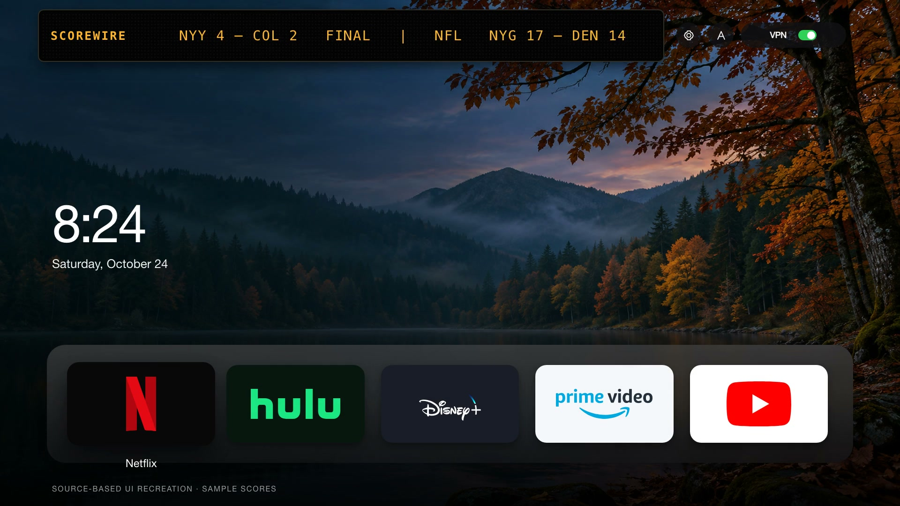
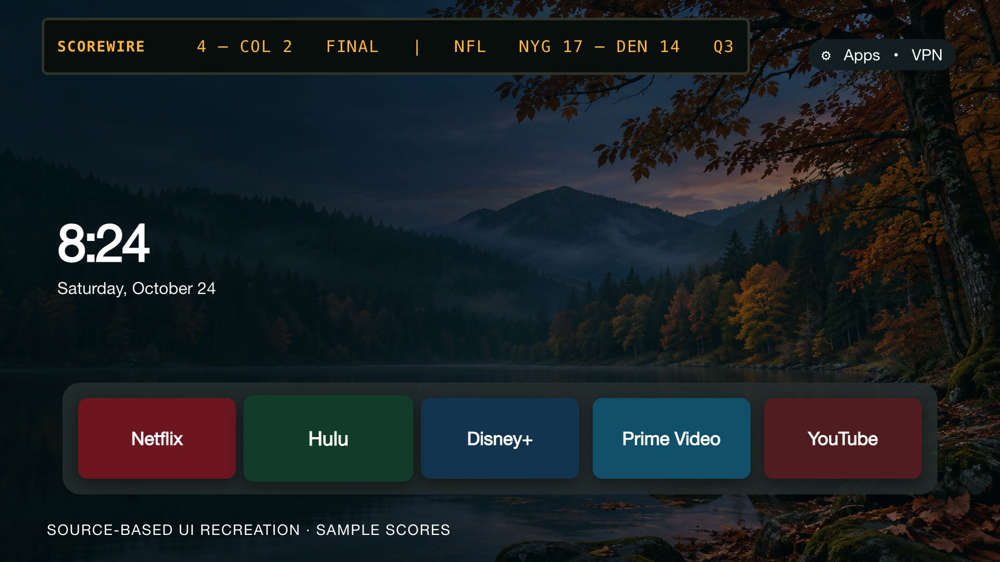

<p align="center">
  
</p>

<h1 align="center">Quiet Home</h1>
<p align="center"><strong>Your apps. Your scores. A little less noise.</strong><br>A minimal, remote-first home screen for Fire TV, built with native Java and Android Canvas.</p>
<p align="center">
  <a href="#get-started">Get started</a> · <a href="docs/INSTALL.md">Install guide</a> · <a href="docs/ARCHITECTURE.md">How it works</a> · <a href="docs/media/brag.mp4">Watch the 22-second demo</a>
</p>
<p align="center">
  
  
  
  
</p>

## A home screen that stays out of the way

Quiet Home puts a small Favorites dock, a clock and an LED sports ticker on a quiet landscape. Press Down for All Apps.

Built as a personal Fire TV project and shared as a working, customizable starting point. No accounts, ad feed, analytics SDKs, backend, Gradle, or runtime dependencies beyond Android. Public sports feeds power the ticker and game status.

[](docs/media/brag.mp4)

*The launch video is a source-based UI recreation with sample scores, not a device recording. Installed app artwork and device behavior will vary.*

| Feature | What it does |
| --- | --- |
| Remote-first navigation | D-pad focus with a 150 ms lift, scale, and shadow transition |
| Favorites + All Apps | Five favorites; discovers additional installed, non-system TV apps |
| Native artwork | Uses installed TV banners, with launcher icons as a fallback |
| SCOREWIRE | Scrolling MLB, NFL, college football, and college baseball scores |
| Game day | Favorite-team live indicator and next-game countdown |
| Network + VPN | Network status and an optional Private Internet Access widget control |

## Get started

**Requirements:** JDK 17, Android SDK command-line tools, Build Tools **35.0.1**, Android platform **35**, and Android platform-tools (`adb`) for installation. The APK supports API 28 and later; Fire OS behavior depends on the device and firmware. This is an experimental sideloaded launcher, not an Amazon Appstore release.

```sh
git clone https://github.com/jakedaltrui/quiet-home.git
cd quiet-home

# Use your own SDK and JDK locations.
export ANDROID_SDK_ROOT=/path/to/android-sdk
export JAVA_HOME=/path/to/jdk-17
export PATH="$JAVA_HOME/bin:$ANDROID_SDK_ROOT/cmdline-tools/latest/bin:$ANDROID_SDK_ROOT/platform-tools:$PATH"

sdkmanager "platforms;android-35" "build-tools;35.0.1" "platform-tools"
./build.sh
```

The result is `dist/quiet-home.apk`, signed with a **local development key** generated in `.local/`. Neither the key nor built APKs belong in source control. Keep the same local key if you want to update your own install without uninstalling it.

On a trusted network, enable ADB debugging on your compatible Fire TV, connect using its address, and accept its authorization prompt:

```sh
adb connect FIRE_TV_IP:5555
adb install -r dist/quiet-home.apk
adb shell am start -n com.jakedaltrui.quiethome/.MainActivity
```

Start it manually first. Home-button redirection and one-tap PIA control are optional, firmware-dependent steps covered in the [install and recovery guide](docs/INSTALL.md). No root or disabling of Amazon's launcher is needed by this project.

## Make it yours

| Change | File |
| --- | --- |
| Favorite apps and their order | `MainActivity.java` → `BASE_APPS` (first five are Favorites) |
| Favorite teams | `ScoreService.java` → `isFavoriteMlb` / `isFavoriteEspn` |
| Wallpaper | `res/drawable-nodpi/forest_background.jpg` |
| Layout, dimensions, colors | `MainActivity.java` → `HomeView` |

Java files live in `src/com/jakedaltrui/quiethome/`. Configuration currently happens in source, followed by a rebuild. Sample team preferences include the Yankees, Rockies, Giants, Broncos, LSU football, and New Orleans baseball. They are examples, not an onboarding flow.

## The technical build

A custom `View` draws the interface directly with Android Canvas. Android's package manager supplies app discovery and artwork. A background worker fetches HTTPS sports feeds and caches successful responses in private preferences. A narrowly scoped accessibility service can bring the activity forward when Amazon Home appears.

See the [architecture and design tradeoffs](docs/ARCHITECTURE.md), [privacy and security notes](SECURITY.md), and [contributing guide](CONTRIBUTING.md).

## Limits worth knowing

- Fire OS updates may block accessibility redirection or widget binding. Manual launch remains the baseline.
- The VPN indicator reports an Android VPN transport; it does not prove a particular provider, exit IP, or privacy guarantee. One-tap control requires compatible PIA widget access; otherwise the PIA app opens.
- Sports feeds may be delayed, incomplete, or change without notice. Cached data can be stale. Sports refresh about once per minute.
- Default settings are intentionally simple and source-configured. No remote settings, provider credentials, or content streaming are included.
- A successful build is not a substitute for testing navigation, sleep/wake, and recovery on your own TV. The public copy has been compile- and signature-verified; it has not been tested across Fire TV models.

## License and credits

Code: [MIT](LICENSE). Original AI-generated wallpaper and project media: [asset notices](docs/ASSETS.md). Public sports data: MLB Stats API and ESPN scoreboard endpoints, subject to their providers' terms. App names and artwork belong to their respective owners; app artwork is loaded from installed packages, not bundled here. This project is independent of Amazon, the streaming services, leagues, and VPN providers.
