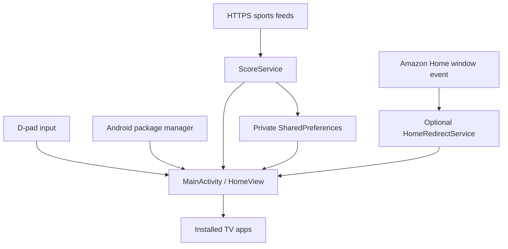

# A native launcher without an app framework

Quiet Home is a small Java Android application. The command-line build compiles resources with `aapt2`, Java with `javac`, bytecode with `d8`, and packages/signs an APK. There is no server, JavaScript runtime, or dependency resolver in the application build.

| Component | Responsibility |
| --- | --- |
| `MainActivity.java` | Lifecycle, app/widget discovery, Canvas drawing, focus, ticker, app launch intents |
| `LedFont.java` | Draws the LED-style glyphs for score displays |
| `ScoreService.java` | Four feed adapters, favorite ordering, next-game and scoring metadata, local caching |
| `HomeRedirectService.java` | Throttled redirect for Amazon Home window events only |

## Decisions and tradeoffs

**Canvas instead of a view hierarchy:** makes the 10-foot interface and LED ticker straightforward, with tight control over focus and animation. It also puts a lot of code in one class and provides fewer native accessibility semantics than standard widgets. Future contributions could extract rendering and improve accessibility.

**Offline tolerance:** successful ticker text persist locally. Failed refreshes reuse cached text. Feed requests have connect/read timeouts and a 2 MiB response cap. These measures bound each response, not every possible runtime or memory failure. A partial multi-league update can still omit unavailable leagues.

**No app artwork downloads:** installed package banners/icons supply artwork. Missing curated apps link to Amazon's Appstore. This launcher does not supply movies, subscriptions, VPN service, or streaming access.

**Optional system integration:** Amazon Home is not replaced or removed. The accessibility service only receives Amazon launcher window-state events and declares `canRetrieveWindowContent=false`. It may stop working after firmware updates.

**Simple configuration:** teams, favorite apps, and timeouts are source constants. This keeps the prototype compact but means customization needs rebuilding.

## Public release validation

The public copy is built independently of the private device workspace. All Java sources compile, the packaged APK's signature verifies, and a clean export can rebuild using the documented SDK/JDK versions. CI repeats the build and checks repository hygiene. Manual device testing remains necessary for launcher navigation, widget binding, firmware behavior, and long idle sessions.
